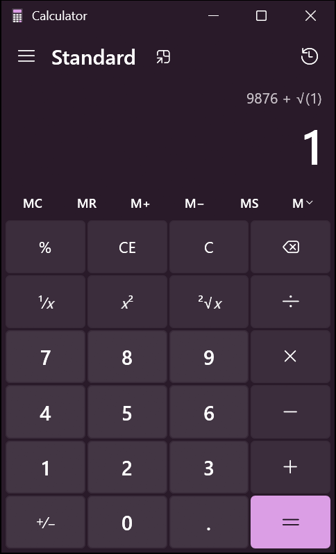

# CalcCraft

Calculator; an open-source reimplementation of Calculator, rebuilt in pure Rust with [eframe/egui](https://github.com/emilk/egui).
It looks like the original (Segoe UI fonts, Fluent icons, the same layout and colors) and behaves like it, down to how the expression line, `%`, repeated `=` and error messages work.



## Features

- **Keypad:** digits, decimal point, `+/−`, `+ − × ÷`, `=`, `%`, `CE`, `C`, `⌫`, `1/x`, `x²`, `√x`.
- **Memory:** `MC`, `MR`, `M+`, `M−`, `MS`, plus the memory list (`M˅`) with per-slot `MC` / `M+` / `M−`.
- **History:** every calculation is logged. Click an entry to bring it back, or use the trash button to clear the list.
- **Keep on top:** a compact always-on-top window, the same as in Windows.
- **Exact arithmetic:** numbers are stored as big rationals, so `0.1 + 0.2 − 0.3` is exactly `0`
  and `1 ÷ 3 × 3` is exactly `1`.
- **Windows behavior:** immediate execution without operator precedence (`2 + 3 × 4 = 20`),
  16 significant digits, Windows' rules for scientific notation, and the same error messages
  (`Cannot divide by zero`, `Result is undefined`, `Invalid input`, `Overflow`).
- **Keyboard and clipboard:** see the shortcuts below. `Ctrl+C` / `Ctrl+V` copy and paste numbers.

## Keyboard shortcuts

| Key | Action |
| --- | --- |
| `0`–`9`, `.` or `,` | Digits and decimal point |
| `+` `-` `*` `/` | Operators |
| `Enter` or `=` | Equals |
| `%` | Percent |
| `@` | Square root |
| `R` | Reciprocal (`1/x`) |
| `Q` | Square (`x²`) |
| `F9` | Negate (`+/−`) |
| `Backspace` | Delete the last digit |
| `Delete` | Clear entry (`CE`) |
| `Esc` | Clear (`C`), or close an open panel |
| `Ctrl+M` / `Ctrl+P` / `Ctrl+Q` / `Ctrl+R` / `Ctrl+L` | `MS` / `M+` / `M−` / `MR` / `MC` |
| `Ctrl+H` | Show or hide history |
| `Ctrl+Shift+D` | Clear history |
| `Ctrl+C` / `Ctrl+V` | Copy the result / paste a number |

## Requirements

- **Windows 10 or 11.** The app was developed and tested on Windows 11. It loads Segoe UI and
  Segoe Fluent Icons (or Segoe MDL2 Assets on Windows 10) from `%WINDIR%\Fonts`.
  Other platforms should build, using egui's default fonts and a plain title bar, but nobody
  has tested them.
- **Rust 1.95 or newer** (edition 2024; eframe 0.36 needs at least 1.95).

## Build and run

```bash
cargo run --release
```

The executable is `target/release/calculator.exe`. Release builds use the Windows GUI
subsystem, so no console window appears. Debug builds (`cargo run`) keep the console, which is
handy for logging.

## Development

```bash
cargo test                                  # engine tests
cargo fmt --check                           # formatting
cargo clippy --all-targets -- -D warnings   # lints
```

All three must pass before a change is merged. Contributors (people and AI agents alike)
should read [AGENTS.md](AGENTS.md) first: it describes the architecture, the Windows behaviors
that the tests pin down, and known pitfalls.

## Project layout

| Path | Contents |
| --- | --- |
| `src/main.rs` | Entry point: window options and the generated window icon |
| `src/engine.rs` | Calculator logic: input state machine, exact arithmetic, number formatting, memory, history, unit tests. No UI code. |
| `src/app.rs` | User interface: custom-painted buttons, display, memory row, history and memory panels, menu, keyboard handling, fonts, title bar tint |
| `docs/screenshot.png` | The screenshot shown above |
| `AGENTS.md` | Guide for contributors and AI coding agents |
| `CLAUDE.md` | Entry point for Claude Code (imports `AGENTS.md`) |

## Differences from Windows Calculator

- Only the Standard mode exists. Scientific, programmer, date and converter modes are not implemented.
- The colors are fixed: the purple dark palette from the reference screenshot. Windows tints
  its window with the Mica effect and your accent color. There is no light theme.
- The text is always English, and numbers always use en-US formatting (`1,234.5`),
  whatever the system locale.
- In wide windows, history and memory open over the keypad instead of in a docked side panel.

## Disclaimer

This is an independent hobby project. It is not affiliated with or endorsed by Microsoft.
Windows and Segoe are trademarks of Microsoft. The fonts are loaded from your Windows
installation and are not part of this repository.

## License

No license has been chosen yet.
