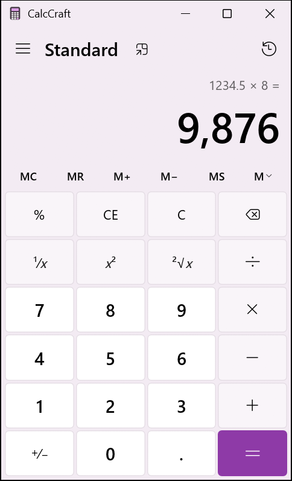
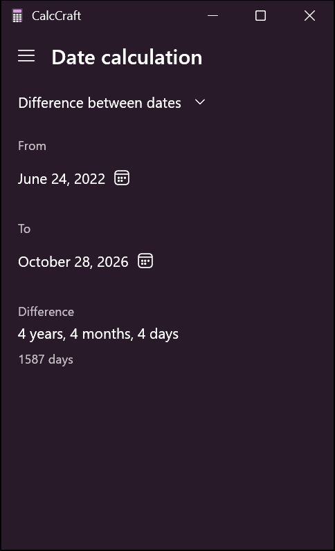

# CalcCraft

Calculator; an open-source reimplementation of Calculator, rebuilt in pure Rust with [eframe/egui](https://github.com/emilk/egui).
It looks like the original (Segoe UI fonts, Fluent icons, the same layout and colors) and behaves like it, down to how the expression line, `%`, repeated `=` and error messages work.

| Dark | Light |
| --- | --- |
|  |  |

## Features

- **Keypad:** digits, decimal point, `+/−`, `+ − × ÷`, `=`, `%`, `CE`, `C`, `⌫`, `1/x`, `x²`, `√x`.
- **Memory:** `MC`, `MR`, `M+`, `M−`, `MS`, plus the memory list (`M˅`) with per-slot `MC` / `M+` / `M−`.
- **History:** every calculation is logged. Click an entry to bring it back, or use the trash button to clear the list.
- **Keep on top:** a compact always-on-top window, the same as in Windows.
- **Settings:** opened from the menu, as in Windows. It has the App theme choice, the app version,
  and links for sending feedback and to the project on GitHub.
- **Light and dark themes:** pick Light, Dark or Use system setting in Settings. With the system
  setting, the app follows the Windows app mode, even when it changes while the app is open.
  The title bar switches with it. The choice is saved in `%APPDATA%\CalcCraft`.
- **Exact arithmetic:** numbers are stored as big rationals, so `0.1 + 0.2 − 0.3` is exactly `0`
  and `1 ÷ 3 × 3` is exactly `1`.
- **Windows behavior:** immediate execution without operator precedence (`2 + 3 × 4 = 20`),
  16 significant digits, Windows' rules for scientific notation, and the same error messages
  (`Cannot divide by zero`, `Result is undefined`, `Invalid input`, `Overflow`).
- **Keyboard and clipboard:** see the shortcuts below. `Ctrl+C` / `Ctrl+V` copy and paste numbers.
- **Date calculation mode** (open the ☰ menu):
  - **Difference between dates:** the difference broken into years, months, weeks and days,
    plus the total number of days (`4 years, 4 months, 4 days`, `1587 days`).
  - **Add or subtract days:** add years, months and days (0–999 each) to a date, or subtract them.
  - The date pickers open a calendar with month, year and decade views. It works with the
    arrows and the mouse wheel, and supports dates from 1601 to 9999, like Windows.



## Keyboard shortcuts

| Key | Action |
| --- | --- |
| `0`–`9`, `.` or `,` | Digits and decimal point |
| `+` `-` `*` `/` | Operators |
| `Enter` or `=` | Equals |
| `%` | Percent |
| `@` | Square root |
| `R` | Reciprocal (`1/x`) |
| `Q` | Square (`x²`) |
| `F9` | Negate (`+/−`) |
| `Backspace` | Delete the last digit |
| `Delete` | Clear entry (`CE`) |
| `Esc` | Clear (`C`), close an open panel, or leave Settings |
| `Ctrl+M` / `Ctrl+P` / `Ctrl+Q` / `Ctrl+R` / `Ctrl+L` | `MS` / `M+` / `M−` / `MR` / `MC` |
| `Ctrl+H` | Show or hide history |
| `Ctrl+Shift+D` | Clear history |
| `Ctrl+C` / `Ctrl+V` | Copy the result / paste a number |

In the date calculation mode, `Esc` closes the open calendar or list, and `Ctrl+C` copies the result.

## Requirements

- **Windows 10 or 11.** The app was developed and tested on Windows 11. It loads Segoe UI and
  Segoe Fluent Icons (or Segoe MDL2 Assets on Windows 10) from `%WINDIR%\Fonts`.
  Other platforms should build, using egui's default fonts and a plain title bar, but nobody
  has tested them.
- **Rust 1.95 or newer** (edition 2024; eframe 0.36 needs at least 1.95).
- **Windows SDK** for `rc.exe`, which embeds the icon into the executable. It comes with the
  Visual Studio C++ build tools that Rust on Windows needs anyway.

## Build and run

```bash
cargo run --release
```

The executable is `target/release/calculator.exe`. Release builds use the Windows GUI
subsystem, so no console window appears. Debug builds (`cargo run`) keep the console, which is
handy for logging.

## Development

```bash
cargo test                                  # calculator and date tests
cargo fmt --check                           # formatting
cargo clippy --all-targets -- -D warnings   # lints
```

All three must pass before a change is merged.
[GitHub Actions](.github/workflows/ci.yml) runs them on Windows for every push and pull request.
Contributors (people and AI agents alike)
should read [AGENTS.md](AGENTS.md) first: it describes the architecture, the Windows behaviors
that the tests pin down, and known pitfalls.

## Releasing

Bump `version` in `Cargo.toml`, merge that change, then push a tag with the same version:

```bash
git tag v1.0.0
```

```bash
git push origin v1.0.0
```

The [release workflow](.github/workflows/release.yml) checks that the tag matches `Cargo.toml`,
runs the tests, builds the release executable on Windows and publishes a GitHub release with
`calculator-v1.0.0-windows-x64.exe`, its SHA-256 checksum and generated release notes.
Tags with a suffix, such as `v1.0.0-beta.1`, are published as pre-releases.

## Project layout

| Path | Contents |
| --- | --- |
| `src/main.rs` | Entry point: window options |
| `src/icon.rs` | The app icon, drawn in code: the window icon and the icon embedded in the executable |
| `build.rs` | Embeds the icon and the version information (CalcCraft, version from `Cargo.toml`) into `calculator.exe` |
| `src/engine.rs` | Calculator logic: input state machine, exact arithmetic, number formatting, memory, history, unit tests. No UI code. |
| `src/dates.rs` | Date logic: difference in years, months, weeks and days; adding and subtracting; date formats; unit tests. No UI code. |
| `src/app.rs` | User interface: custom-painted buttons, display, memory row, history and memory panels, menu, Settings, keyboard handling, fonts, title bar tint |
| `src/app/palette.rs` | The dark and light color palettes |
| `src/app/date_view.rs` | User interface of the date calculation mode: date pickers, calendar, drop-down lists |
| `docs/screenshot.png`, `docs/screenshot-light.png`, `docs/date-calculation.png` | The screenshots shown above |
| `.github/workflows/` | GitHub Actions: CI checks and the release build |
| `AGENTS.md` | Guide for contributors and AI coding agents |
| `CLAUDE.md` | Entry point for Claude Code (imports `AGENTS.md`) |

## Differences from Windows Calculator

- Only the Standard and Date calculation modes exist. The scientific, graphing, programmer and
  converter modes are not implemented.
- Dates always use the Gregorian calendar, en-US formats (`October 15, 2026`) and weeks that
  start on Sunday, whatever the system settings.
- The palettes are fixed: both themes use the purple tint and accent color of the reference
  screenshots. Windows tints its window with the Mica effect and your own accent color.
  The light background is an estimate, not a sample.
- There is no high contrast theme.
- The About section in Settings shows only the name and version, without the license and
  privacy links.
- The text is always English, and numbers always use en-US formatting (`1,234.5`),
  whatever the system locale.
- In wide windows, history and memory open over the keypad instead of in a docked side panel.

## Disclaimer

This is an independent hobby project. It is not affiliated with or endorsed by Microsoft.
Windows and Segoe are trademarks of Microsoft. The fonts are loaded from your Windows
installation and are not part of this repository.

## Acknowledgements & Credits

This project is heavily inspired by and builds upon the architecture and logic of the official [Microsoft Calculator](https://github.com/Microsoft/calculator) repository, licensed under the [MIT License](https://github.com/microsoft/calculator/blob/main/LICENSE).

> **Disclaimer:** This project is an independent, community-driven port to Rust and is **not** affiliated with, endorsed by, or in any way officially connected with Microsoft Corporation.

We gratefully acknowledge Microsoft and the contributors of the original project for their work.
